# PROJET — Portail de suivi des tournées · Rendu

**David.K** · Administration d'un Linux Server (BTC2). Cible : `srv-core2` (Rocky 9, 1 vCPU). Poste distant : `srv-edge` (Ubuntu 24.04). Déploiement du 5 novembre 2026 avec `scripts/projet.sh`, une étape par exigence. Le tableau de conformité, les justifications et les limites sont dans `RAPPORT.md`, les sorties brutes dans `preuves/`.

## Figure 1 : instantané avant de commencer

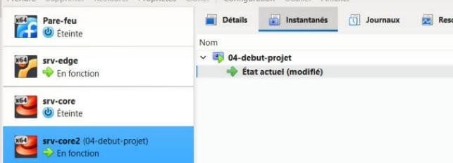

L'instantané `04-debut-projet` est pris sur srv-core2 avant toute modification. Les 5 prérequis de fin de TP3 passent : collecteur actif, zone par défaut `drop`, sshd sur 2242 sans mot de passe, timer de détection actif, SELinux `Enforcing`.

## Figure 2 : agent Zabbix installé en premier (E8.1)

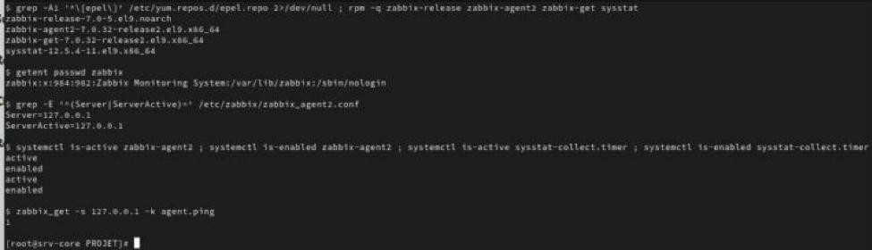

EPEL est exclu pour les paquets zabbix, donc c'est le 7.0 officiel qui s'installe (`zabbix-agent2-7.0.32`). Le paquet crée le compte `zabbix`, nécessaire pour l'ACL de E2. `Server=127.0.0.1` n'est pas modifié, et `agent.ping` répond `1`. sysstat et son timer de collecte sont actifs.

## Figure 3 : comptes (E1)

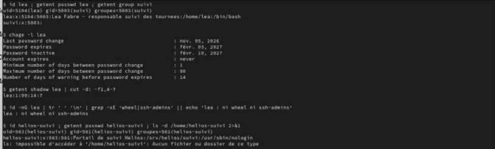

lea a l'UID 5104, le groupe principal `suivi` (5003), le bon commentaire et la politique `1:90:14:7`. Elle n'est ni dans `wheel` ni dans `ssh-admins`. `helios-suivi` est un compte système sans shell et sans `/home`. L'UID 5104 était déjà pris par `sysops` (TP3) : je l'ai renuméroté en 5105, voir RAPPORT §5.

---

## Figure 4 : répertoire publié, setgid et ACL par défaut (E2)

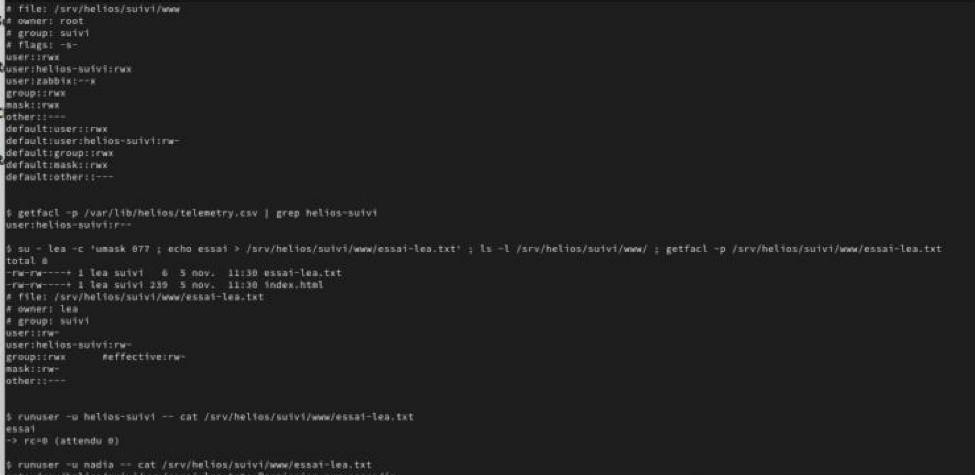

`www` appartient à `root:suivi`, en `2770`. Les ACL donnent `rwx` à helios-suivi et `--x` à zabbix. Les entrées `default:` font que tout fichier créé dedans est `rw` pour le groupe et pour helios-suivi, et rien pour les autres. lea crée un fichier avec `umask 077` : il sort quand même en `-rw-rw----+ lea suivi`. helios-suivi le lit (rc=0), nadia non (« Permission non accordée »).

## Figure 5 : ce qui se passe sans l'entrée zabbix

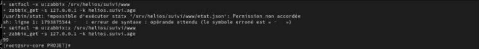

Sans `u:zabbix:x`, `stat` est refusé et la sonde d'âge renvoie une erreur de syntaxe du shell au lieu d'un nombre. Avec `--x`, elle renvoie `99`. Le droit `x` suffit pour atteindre `etat.json` par son nom, sans pouvoir lister le répertoire.

## Figure 6 : script de publication, codes retour (E3)

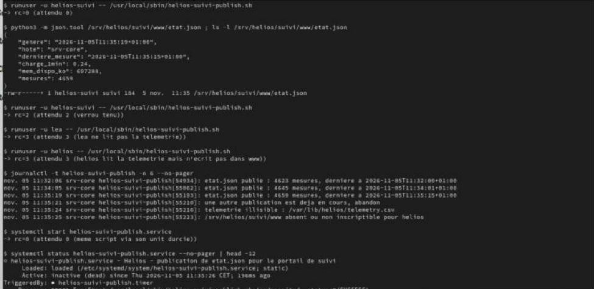

En helios-suivi : `rc=0` et un JSON valide. Pendant qu'un `flock` tient le verrou : `rc=2`. En lea (elle ne lit pas la télémétrie) et en helios (il n'écrit pas dans www) : `rc=3`. Chaque cas laisse une ligne dans le journal (`logger -t helios-suivi-publish`). L'écriture passe par `mktemp` dans www puis `mv`, donc le portail ne sert jamais un fichier à moitié écrit.

---

## Figure 7 : portail durci et redémarrage automatique (E4)

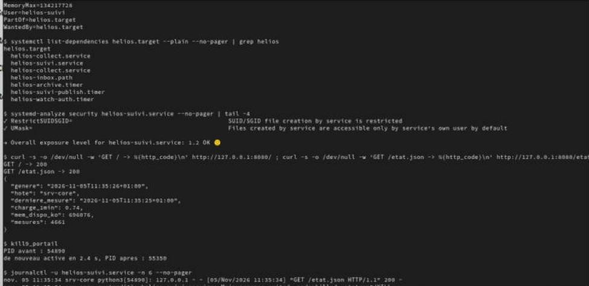

`helios-suivi.service` tourne sous helios-suivi, avec `MemoryMax=128M` et `CPUQuota=50%`. Il fait partie de `helios.target` (`PartOf` / `WantedBy`). Score `systemd-analyze security` : **1.2 OK**, sans avoir eu à retirer une seule directive. `GET /` et `GET /etat.json` répondent 200. Après un `kill -9`, systemd le relance en **2,4 s** (`Restart=always`, `RestartSec=2s`).

## Figure 8 : délégation sudo de lea (E5)

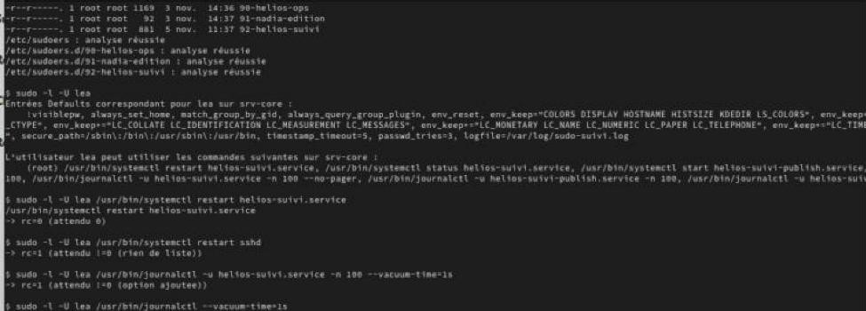

Le fichier `92-helios-suivi` passe `visudo -c` et se trouve en `0440 root:root`. `sudo -l -U lea` liste 3 commandes systemctl et 4 commandes journalctl, toutes écrites en entier. `restart sshd` n'est pas listé, et l'ajout de `--vacuum-time=1s` est refusé (rc=1) : sans joker, aucune option ne peut être ajoutée.

## Figure 9 : essais réels en lea

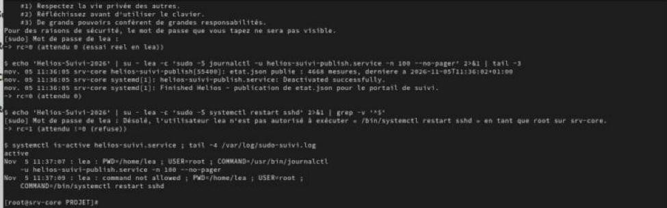

lea lit le journal de la publication en `sudo`. Pour `systemctl restart sshd`, elle obtient « n'est pas autorisé ». Les deux sont tracés dans `/var/log/sudo-suivi.log`.

## Figure 10 : 8080 ouvert dans internal seulement (E6)

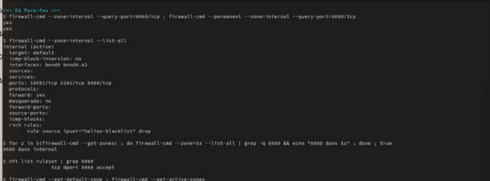

8080/tcp est ajouté en runtime et en permanent dans `internal` (bond0, bond0.42). Une boucle sur toutes les zones ne le trouve que là, et nftables n'a qu'une seule règle `tcp dport 8080 accept`. La zone par défaut reste `drop`.

---

## Figure 11 : vérification depuis srv-edge (E6, E7)

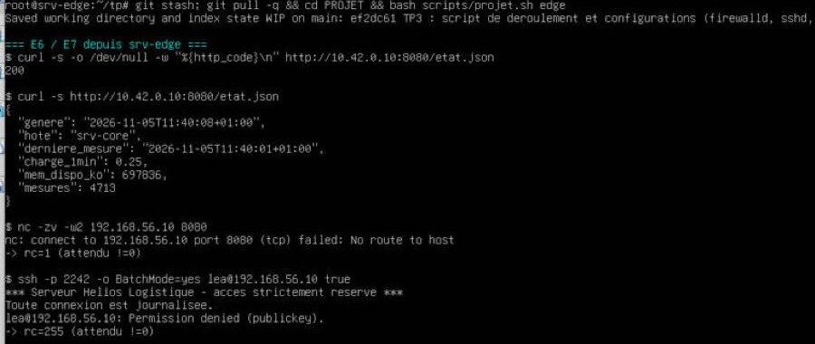

Par le réseau métier (10.42.0.10), le portail répond 200 et donne le JSON. Par le réseau d'administration (192.168.56.10), 8080 est refusé. lea ne peut pas se connecter en SSH (`publickey` seulement, et pas dans `ssh-admins`).

## Figure 12 : non-régression (E7)

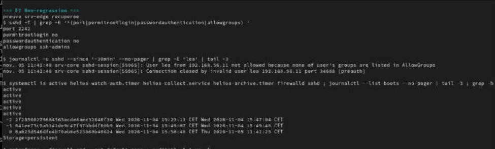

Les 4 directives `sshd -T` sont identiques à la fin du TP3. Côté serveur, le refus de lea est journalisé. Les services et timers des TP1 à TP3 sont actifs, journald est persistant, SELinux `Enforcing`, et les 12 règles auditd sont toujours chargées.

## Figure 13 : sondes Zabbix (E8)

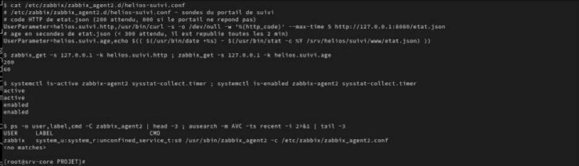

`helios.suivi.http` renvoie `200` et `helios.suivi.age` renvoie `60` (moins de 300). Les commandes ont des chemins absolus. L'agent tourne en `unconfined_service_t` et `ausearch -m AVC` ne trouve rien.

## Figure 14 : sauvegarde, empreinte, rotation, verrou (E9)

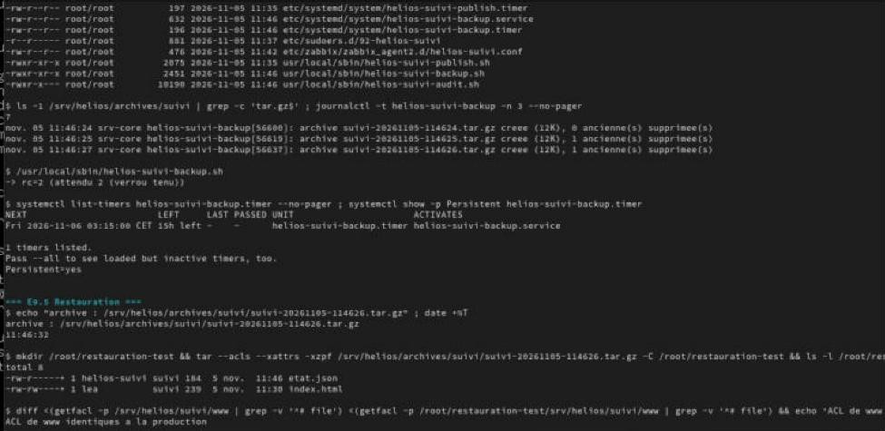

`tar --acls --xattrs --selinux` garde les ACL. L'archive et son `.sha256` sont écrits dans `/srv/helios/archives/suivi` (`helios:helios 0750` au-dessus). Après 9 passages, il reste **7** archives. Une deuxième instance pendant la sauvegarde rend `rc=2`. Le timer est à 03:15 avec `Persistent=yes`.

---

## Figure 15 : restauration de index.html seul (E9.5)

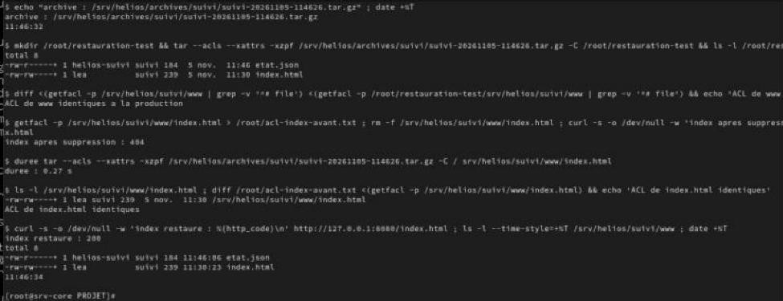

(a) L'archive extraite dans `/root/restauration-test` a les mêmes ACL que la production. (b) `index.html` est supprimé (404), puis on n'extrait que ce fichier en **0,27 s**. Il revient avec lea:suivi, sa date et ses ACL (`diff` vide), et répond 200. `etat.json` n'a pas été touché.

## Figure 16 : mesure sous charge (RAPPORT §4)

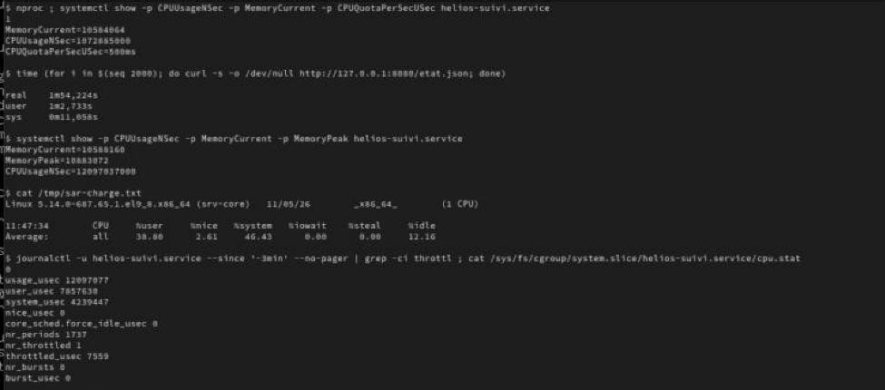

Pendant 2000 `curl` (114 s), le portail consomme 11,0 s de CPU, soit environ 10 % d'un CPU. La mémoire reste à 10,6 Mo (pic 10,9 Mo). `sar` montre une machine à 85 % occupée, mais c'est la boucle cliente qui la charge. `nr_throttled 1` : le quota de 50 % n'a pratiquement pas servi.

## Figure 17 : audit de conformité, puis deux pannes (E10, bonus)

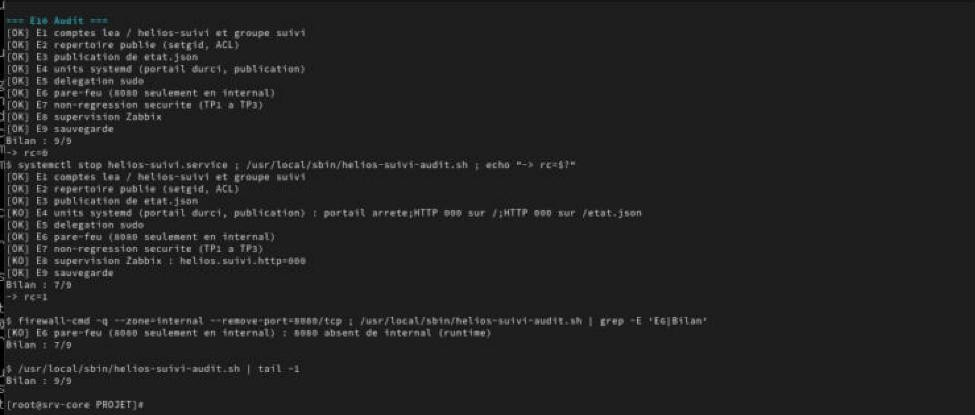

Sur le serveur conforme : `Bilan : 9/9`, `rc=0`. Portail arrêté : E4 et E8 passent en KO, `rc=1`. 8080 retiré du runtime : `[KO] E6 … 8080 absent de internal (runtime)`. Après remise en état : 9/9. Le 6 novembre, après un redémarrage complet des VM, l'audit donne encore 9/9 sans rien toucher. Au premier passage, l'audit avait deux faux KO, causés par `grep -q` avec `pipefail` et par la lecture du score. Je les ai corrigés, voir RAPPORT §5.
