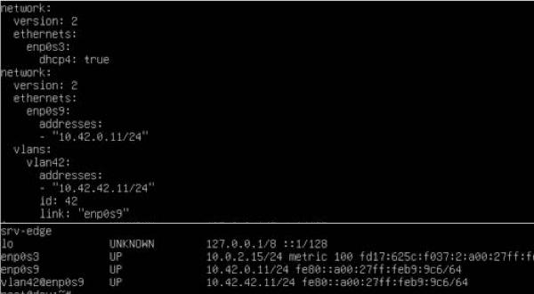
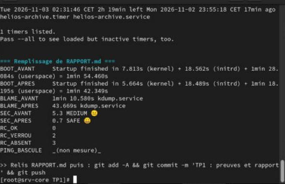
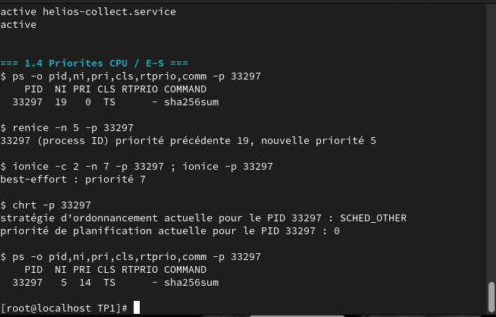
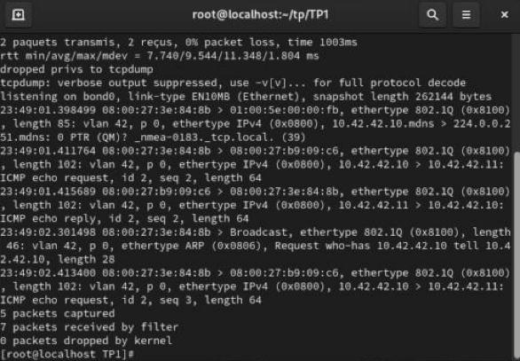
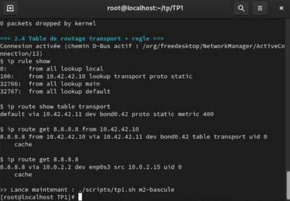
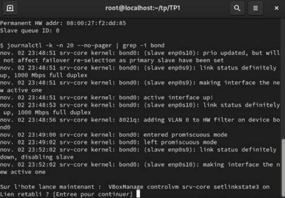
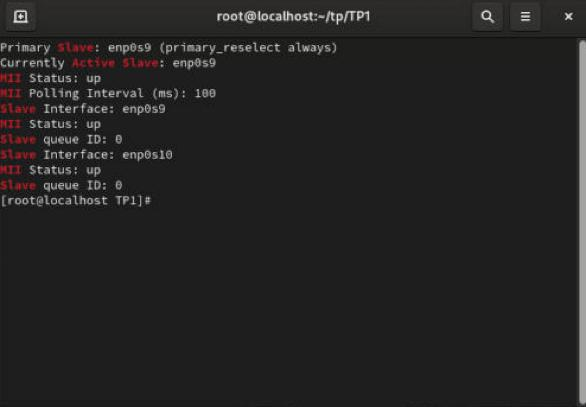
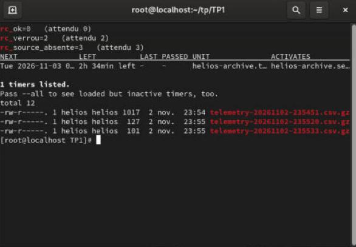
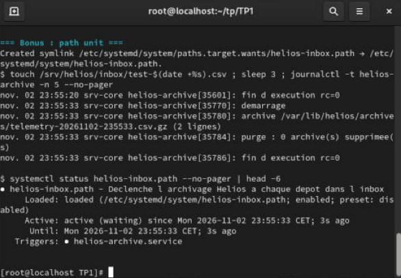

# TP1 — Configuration avancée du système Linux · Rendu

**David.K** · Administration d'un Linux Server (BTC2) · Jour 1/5
**VM :** `srv-core2` (Rocky Linux 9, hostname `srv-core`) et `srv-edge` (Ubuntu 24.04), reliées par le réseau interne VirtualBox `helios-lan`.
Le détail (rôle de chaque directive, comparatif cron/timer) est dans `RAPPORT.md`, et les sorties brutes sont dans `captures/`.

## Figure 1 : câblage des VM

`srv-core2` garde l'adaptateur 1 en NAT (`enp0s3`, accès Internet et route par défaut). J'ai ajouté les adaptateurs 3 et 4 sur le réseau interne `helios-lan`, qui deviennent `enp0s9` et `enp0s10` dans la VM et servent de ports au bond. `srv-edge` est branché sur le même réseau par son adaptateur 3. Il faut éteindre les VM avant d'ajouter des cartes.

## Figure 2 : srv-edge, IP métier et VLAN 42 (netplan)

srv-edge tourne sous Ubuntu : son réseau est géré par netplan et non par NetworkManager. `netplan set` écrit la configuration de manière persistante dans `/etc/netplan/70-netplan-set.yaml`. On obtient `enp0s9` en 10.42.0.11/24 (réseau métier) et la sous-interface `vlan42@enp0s9` en 10.42.42.11/24 (VLAN « transport »). Le VLAN doit être déclaré en une seule fois, avec `id` et `link` ensemble, sinon netplan refuse la définition.

---

## Figure 3 : temps de boot et durcissement du service

**Boot :** 1 min 54 s avant, 1 min 42 s après. J'ai désactivé `firewalld` (temporaire, il sera réactivé au TP3) et masqué `NetworkManager-wait-online`. `blame` montre que l'unité la plus lente est `kdump.service` (70 s puis 44 s).
**Sécurité :** le score `systemd-analyze security` passe de **5.3 MEDIUM** à **0.7 SAFE** grâce au drop-in `override.conf`. Ce drop-in ajoute `PrivateNetwork`, `ProtectKernel*`, `SystemCallFilter`, etc., sans modifier l'unit d'origine. Il applique aussi `CPUQuota=20%`, `MemoryMax=96M`, `IOWeight=50`, `Nice=5` et `HELIOS_INTERVAL=5`.
**`kill -9` :** le PID 26962 est tué, systemd journalise `status=9/KILL` puis relance le service 5 s plus tard (`RestartSec`) sous le PID 28222, avec `NRestarts=1`. Le champ `PING_BASCULE` est vide sur la capture parce que le script cherchait la sortie anglaise de `ping` (le résultat est en figure 8).

## Figure 4 : priorités CPU et E/S d'un processus en cours

`nice -n 19` lance `sha256sum` avec la priorité la plus basse (NI 19). En root, `renice -n 5` la **remonte** à 5 : seul root peut faire ça. `ionice -c 2 -n 7` place le processus en classe *best-effort*, niveau 7 (le plus faible). `chrt -p` confirme la politique `SCHED_OTHER` : c'est un processus ordinaire, pas temps réel.

---

## Figure 5 : VLAN 802.1Q 42 sur le bond

`tcpdump -e` sur `bond0` capture le ping vers 10.42.42.11. Chaque trame porte `ethertype 802.1Q (0x8100), vlan 42`, ce qui prouve que le marquage VLAN est fait par `bond0.42`. srv-edge répond (*ICMP echo reply*), donc les deux extrémités sont dans le même VLAN.

## Figure 6 : routage par règles (table `transport`)

J'ai créé la table 142 `transport`, avec une route par défaut via srv-edge (10.42.42.11) et la règle `priority 100 from 10.42.42.10 lookup transport`. Avec `from 10.42.42.10`, le trafic sort par `bond0.42` en utilisant la table `transport`. Sans `from`, il suit la table `main` et sort par `enp0s3` (NAT). Route et règle sont portées par le profil NetworkManager, elles survivent donc au redémarrage (vérifié dans `captures/reseau-apres-reboot.txt`).

---

## Figure 7 : bascule du bond active-backup

Un ping tourne en continu pendant que je débranche le câble virtuel de l'adaptateur 3. Le noyau détecte la panne en moins de 100 ms (`miimon=100`) : `enp0s9 link status definitely down`, puis `enp0s10` devient l'interface active. Le trafic continue sur le second lien sans rien reconfigurer.

## Figure 8 : retour sur le lien primaire

Une fois le câble rebranché, les deux ports sont `MII Status: up`, et `primary=enp0s9` (`primary_reselect always`) fait revenir le bond sur `enp0s9`. Bilan du ping sur tout le test : **3 pertes sur 80**, cumulées sur la coupure et sur le retour. C'est une de plus que la cible de 2. On peut corriger avec `primary_reselect=failure` (pas de seconde bascule au retour du lien) ou `num_grat_arp=3`.

---

## Figure 9 : script d'archivage et timer systemd

`helios-archive.sh` suit les règles d'un script de production : `set -euo pipefail`, verrou `flock -n`, `trap` pour le nettoyage, journalisation via `logger`. Les trois cas testés renvoient les codes attendus : **0** (exécution normale), **2** (une autre instance tient le verrou), **3** (`telemetry.csv` absent). Le timer se déclenche à 02:30, plus un décalage aléatoire de 0 à 2 min (`RandomizedDelaySec`), d'où la prochaine exécution affichée à 02:31:46. Avec `Persistent=yes`, une exécution manquée pendant que la VM est éteinte est rattrapée au démarrage suivant, ce que cron ne sait pas faire. Les archives `.csv.gz` sont bien créées.

## Figure 10 : bonus, path unit

`helios-inbox.path` surveille `/srv/helios/inbox` avec `PathChanged=`. Un `touch` d'un fichier dans l'inbox déclenche immédiatement `helios-archive.service` : le journal montre le démarrage, l'archive créée et `rc=0`. J'ai choisi `PathChanged` plutôt que `PathExistsGlob` pour éviter que le service soit relancé en boucle tant qu'un fichier reste dans l'inbox.
