# TP2 — Comptes, permissions avancées, ACL et sudo · Rendu

**David.K** · Administration d'un Linux Server (BTC2) · Jour 2/5, suite du TP1 sur `srv-core2` (Rocky Linux 9, `/` en XFS).
Le détail (tableau umask, inventaire setuid, audit) est dans `RAPPORT.md`, et les sorties brutes sont dans `captures/`. J'ai masqué l'empreinte du mot de passe root visible en figure 11.

## Figure 1 : groupes, comptes et administrateur de groupe

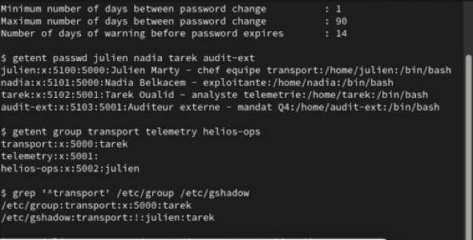

J'ai posé la politique **avant** de créer les comptes, parce que `login.defs` n'est lu qu'au `useradd` : `PASS_MAX_DAYS 90`, `PASS_MIN_DAYS 1`, `PASS_WARN_AGE 14` et `UMASK 027`. `chage -l` le confirme. J'ai créé les groupes `transport` (5000), `telemetry` (5001) et `helios-ops` (5002), puis les comptes avec des UID fixes. Le 3ᵉ champ de `/etc/gshadow` (`transport:!:julien:tarek`) désigne julien comme **administrateur du groupe** (`gpasswd -A`). Il a ajouté nadia lui-même, sans être root.

## Figure 2 : mot de passe faible refusé

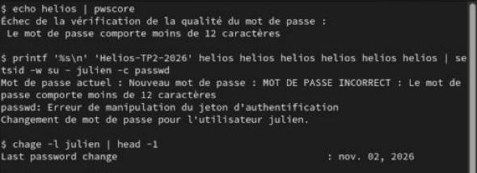

`pwquality` (`minlen=12`, `minclass=3`, `dictcheck`, `usercheck`, `enforce_for_root`) rejette `helios` dans `pwscore` comme dans `passwd`. La date de dernier changement ne bouge pas : le mot de passe n'a pas été modifié.

---

## Figure 3 : verrouillage après 5 échecs (faillock)

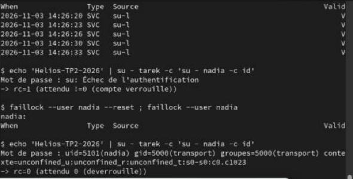

J'ai activé `pam_faillock` avec `authselect enable-feature with-faillock` (`deny=5`, `unlock_time=600`). Après 6 essais faux, `faillock` liste 5 échecs, et même le **bon** mot de passe est refusé (`rc=1`). `faillock --reset` déverrouille, et la connexion passe (`rc=0`).

## Figure 4 : setgid sur le répertoire partagé

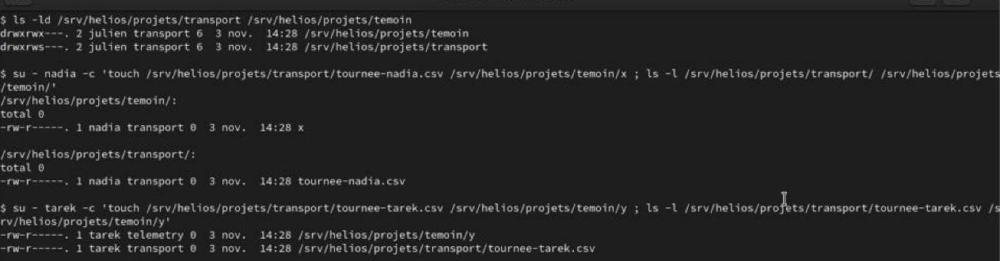

`transport` est en `2770` (le `s` à la place du `x` du groupe) ; le témoin `temoin` est en `0770`. Un fichier créé par tarek (groupe primaire `telemetry`) dans `transport` prend le groupe **transport** du répertoire. Dans `temoin`, il garde `telemetry`. Toute l'équipe peut donc travailler sur les mêmes fichiers.

## Figure 5 : sticky bit

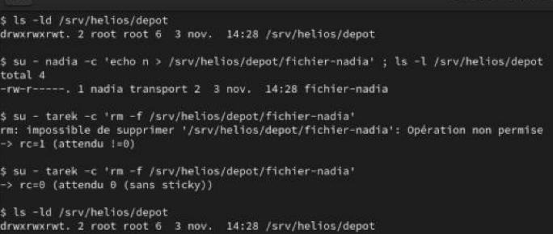

Dans `/srv/helios/depot` (`1777`, le `t` final), tarek ne peut pas supprimer le fichier de nadia (« Opération non permise », `rc=1`). Sans le sticky bit (`0777`), la suppression réussit (`rc=0`). J'ai remis le bit ensuite.

---

## Figure 6 : umask de base et umask par groupe

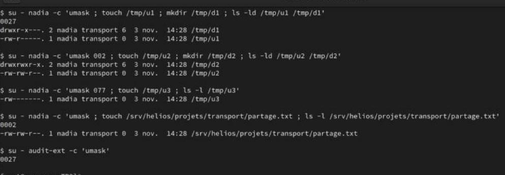

Le umask 027 donne `640` aux fichiers et `750` aux répertoires, 002 donne `664`/`775` et 077 donne `600`, conformément au calcul `0666/0777 & ~umask`. Après le déploiement de `/etc/profile.d/helios-umask.sh`, les membres de `transport` (nadia) reçoivent `0002` et les autres (audit-ext) gardent `0027`. Effet de bord relevé à l'audit : 002 donne aussi `r` aux « autres ».

## Figure 7 : binaire setgid `helios-lastlog`

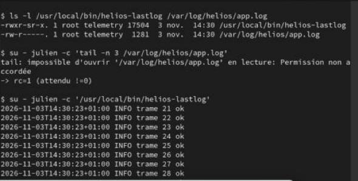

`app.log` est en `0640 root:telemetry` : julien ne peut pas le lire avec `tail` (`rc=1`). Le binaire compilé en `2755 root:telemetry` lui montre les 10 dernières lignes. Il appelle `execle("/usr/bin/tail", …)` avec un chemin absolu, des arguments fixes et un environnement réduit (`PATH`, `IFS`). Le setgid suffit, pas besoin de root. Un **script** en `4755` reste exécuté sous l'UID de l'appelant, car le noyau ignore le setuid sur `#!`.

## Figure 8 : ACL nominative et ACL par défaut

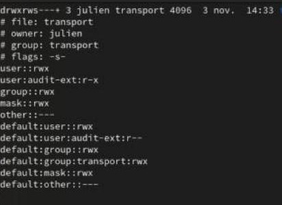

`setfacl -R -m u:audit-ext:rX` donne la lecture seule à l'auditeur. Le `X` ajoute `x` uniquement sur les répertoires. Les ACL par défaut (`d:u:audit-ext:r`, `d:g:transport:rwx`, `d:o::---`) s'appliquent aux **nouveaux** fichiers et sous-dossiers : audit-ext lit `tournee-j2.csv` sans qu'on ait à refaire de `setfacl`.

---

## Figure 9 : le masque, ou pourquoi `chmod g-w` bride tout le monde

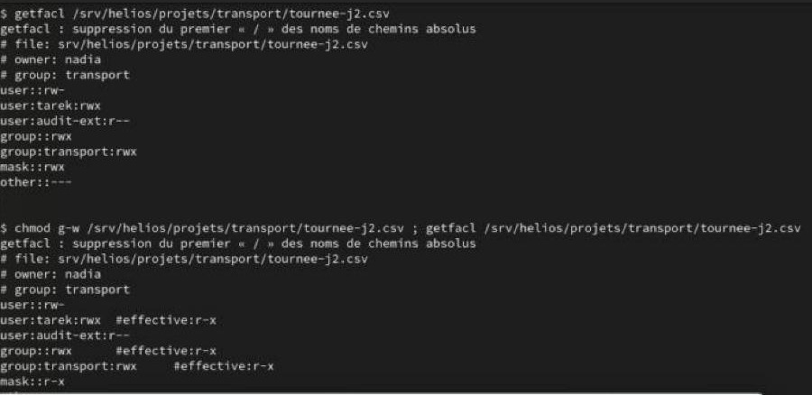

tarek a une entrée `rwx`, et pourtant, après `chmod g-w`, toutes les entrées passent à `#effective:r-x`. Quand un fichier a une ACL étendue, les bits « groupe » de `chmod` modifient le **masque** et non `group::`. Le masque est la limite haute de toutes les entrées nommées et du groupe propriétaire. tarek ne peut plus écrire (`rc=1`) jusqu'au `setfacl -m m::rwx`. J'ai aussi testé la sauvegarde : `getfacl -R`, puis `setfacl -R -b` et `--restore`, retrouve tout. `cp -a` et `tar --acls` conservent les ACL ; `cp -r` les perd.

## Figure 10 : délégation sudo restreinte à `helios-ops`

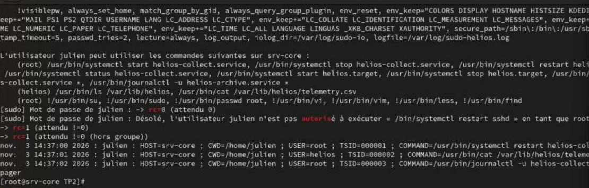

`/etc/sudoers.d/90-helios-ops` a été validé par `visudo -cf` avant installation. Il définit des `Cmnd_Alias` pour le service et les journaux, la lecture des données en tant que `helios` et non root, `!DANGEREUX`, `log_output` et `timestamp_timeout=5`. julien redémarre `helios-collect` (`rc=0`), mais pas `sshd` (« n'est pas autorisé », `rc=1`). Les sessions sont enregistrées : `sudoreplay -l` liste les 3 TSID.

---

## Figure 11 : évasion root via `sudo vim`

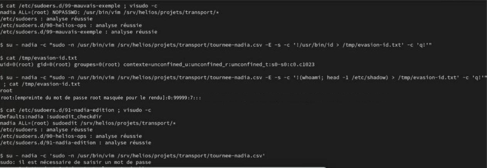

La règle piège `nadia … NOPASSWD: /usr/bin/vim /srv/helios/projets/transport/*` laisse passer des **arguments en plus** grâce au joker. `-c '!commande'` fait exécuter un shell par vim, qui tourne en root : `id` répond `uid=0(root)`, et nadia lit `/etc/shadow` (empreinte masquée). On ne donne jamais à un éditeur, un pager ou `find` des droits root par sudo. J'ai supprimé la règle.

## Figure 12 : correction avec `sudoedit`

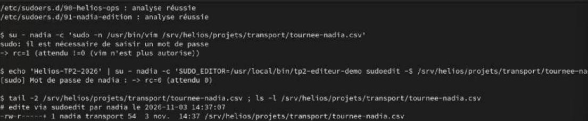

Avec `nadia ALL=(root) sudoedit /srv/helios/projets/transport/*` (et `!sudoedit_checkdir`, car le dossier est inscriptible par son groupe), l'éditeur tourne **sous l'identité de nadia**, sur une copie. Seule la recopie est faite en root. `sudo vim` est maintenant refusé (`rc=1`), et `sudoedit` modifie bien le fichier (`rc=0`), qui garde son propriétaire.

## Bonus : audit en lecture seule, cinq constats

| # | Constat | Remédiation |
|---|---|---|
| 1 | umask 002 du groupe `transport` : fichiers en `rw-rw-r--`, lisibles par tout compte qui traverse le dossier (audit-ext lit `nouvelle.csv`). | `umask 007` dans `helios-umask.sh`, puis `chmod -R o-rwx` sur l'existant. |
| 2 | `journalctl -u helios-collect.service *` : le joker accepte `-u sshd` (lire tous les journaux) ou `--vacuum-time=1s` (effacer des traces). | Options figées dans la règle (`-n 200 --no-pager`) ou script wrapper root. |
| 3 | `/srv/helios/depot` en `1777 root:root` : tout compte, auditeur compris, peut y écrire et remplir le disque. | `root:transport` en `1770`, plus un quota. |
| 4 | Binaires setuid inutiles sur un serveur : `vmware-user-suid-wrapper`, `Xorg.wrap`, `fusermount`, `pkexec` (PwnKit). | Retirer les paquets ou faire `chmod u-s`, et tenir un inventaire de référence. |
| 5 | ACL nominative `user:tarek:rwx` restée sur `tournee-j2.csv`. | `setfacl -x u:tarek`, car le groupe suffit. Revue régulière avec `getfacl -R -s`. |

Points sains : aucun compte sans mot de passe, `sudoers.d` en `0440`, répertoires personnels en `0700`, audit-ext sans sudo et avec une date d'expiration fixée.
