# TP3 — Pare-feu, durcissement SSH, journaux · Rendu

**David.K** · Administration d'un Linux Server (BTC2) · Jour 3/5. Cible : `srv-core2` (Rocky 9). Poste distant et attaquant : `srv-edge` (Ubuntu 24.04), relié par le réseau d'administration 192.168.56.0/24 (adaptateur « réseau privé hôte »).
Le détail est dans `RAPPORT.md` : tableau des zones, crypto-policies, requêtes d'investigation, conséquences du changement de port. Les sorties brutes sont dans `captures/`.

## Figure 1 : scan nmap avant / après la mission 1, et limite de débit

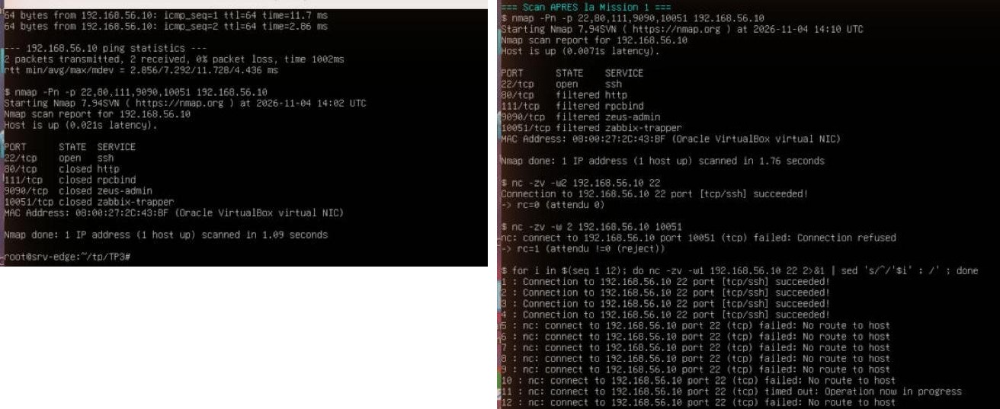

**À gauche, avant** : firewalld est arrêté depuis le TP1. Seul 22 est ouvert, mais 80, 111, 9090 et 10051 répondent « closed », ce qui révèle une machine active. **À droite, après** : tout est « filtered » sauf SSH. `nc` vers 10051 est rejeté. Dans une rafale de 12 connexions, les 4 premières passent, puis la règle `limit value="6/m"` les rejette (« No route to host »).

## Figure 2 : zone par défaut drop, une zone par interface

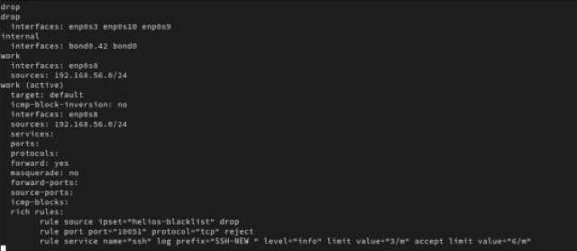

La zone est déclarée dans le profil NetworkManager (`connection.zone`) :

- NAT `enp0s3` → **drop** ;
- administration `enp0s8` → **work**, limitée en plus à la source 192.168.56.0/24 ;
- métier `bond0` / `bond0.42` → **internal**.

Dans `work`, la seule entrée SSH est une règle riche qui **journalise** (préfixe `SSH-NEW`, 3/min) et **limite** à 6/min. Il y a aussi un `reject` explicite sur Zabbix et un `drop` en tête pour l'ipset `helios-blacklist`.

---

## Figure 3 : traces du noyau SSH-NEW et REJECT

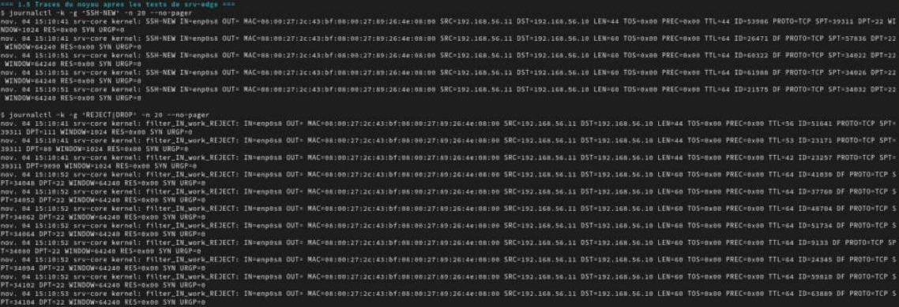

Les nouvelles connexions SSH acceptées laissent une ligne `SSH-NEW` : interface, MAC, source 192.168.56.11, port, drapeau SYN. Celles au-delà de la limite, et les ports fermés scannés par nmap (80, 9090…), sont tracées par `--set-log-denied` sous le préfixe `filter_IN_work_REJECT`. La chaîne nftables générée (`filter_IN_work` : `_pre`/`_log`/`_deny`/`_allow` puis reject `admin-prohibited`) est dans `captures/m1-nftables.txt`. `iptables -S` est vide : ce n'est plus qu'une façade.

## Figure 4 : clé ed25519 de sysops déposée AVANT de couper les mots de passe

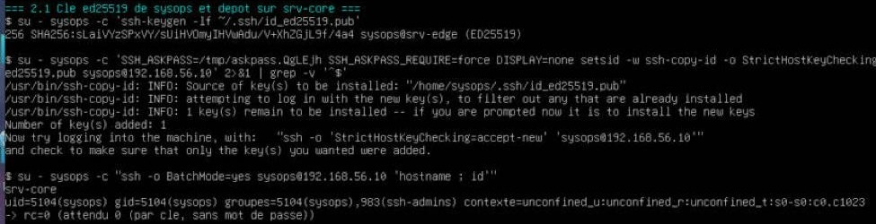

Sur srv-edge, `ssh-keygen -t ed25519 -a 100`, puis `ssh-copy-id`. Le mot de passe du compte de TP est fourni par `SSH_ASKPASS` et le fichier est supprimé juste après. La connexion par clé `ssh -o BatchMode=yes` réussit (`rc=0`, groupes `sysops ssh-admins`). C'est seulement ensuite que le drop-in coupe les mots de passe : la console VirtualBox reste ouverte en secours.

## Figure 5 : première conséquence du port 2242, SELinux

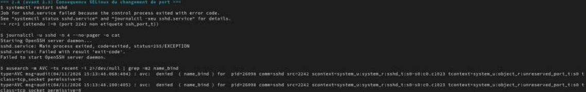

Avec `Port 2242`, sshd refuse de démarrer (`status=255`). `ausearch -m AVC` montre la cause : `denied { name_bind } … src=2242 … unreserved_port_t`. Le domaine `sshd_t` ne peut se lier qu'aux ports `ssh_port_t`. `semanage port -a -t ssh_port_t -p tcp 2242` corrige. La deuxième conséquence est le pare-feu : règle riche sur 2242, retrait du service ssh. La troisième concerne les clients et outils, qui doivent utiliser `-p 2242`.

---

## Figure 6 : port, pare-feu et algorithmes après durcissement

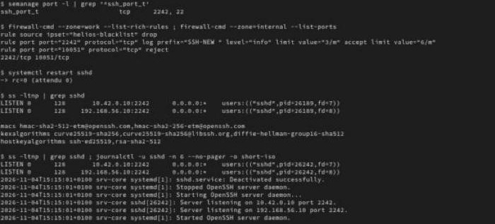

`semanage port -l` donne `2242, 22`. sshd écoute **seulement** sur 10.42.0.10 et 192.168.56.10, en port 2242. Les algorithmes : `update-crypto-policies --set DEFAULT:NO-SHA1` laissait encore `hmac-sha1` en MAC. Le drop-in `05-helios-crypto.conf` est lu **avant** `50-redhat.conf`, qui inclut la politique système, et sshd garde la première valeur lue. Il ramène les MAC à `hmac-sha2-*-etm`, les KEX à `curve25519` / `dh-group16-sha512` et les clés d'hôte à `ed25519` / `rsa-sha2-512`.

## Figure 7 : tests 1 à 5 depuis srv-edge

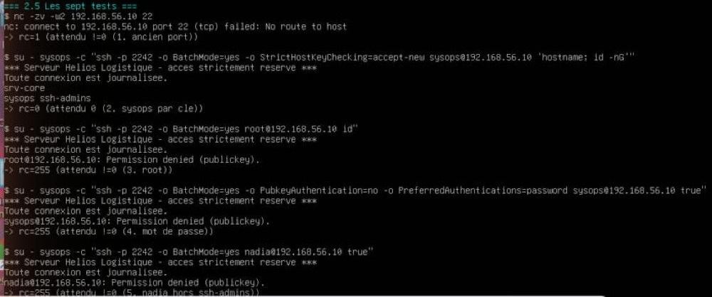

1. Ancien port 22 : rejeté (rc=1).
2. sysops : connecté par clé, avec la bannière `/etc/issue.net`.
3. root : refusé, `PermitRootLogin no`, et root n'est pas dans `ssh-admins`.
4. Mot de passe forcé : refusé, le serveur ne propose que `publickey`.
5. nadia : refusée par `AllowGroups ssh-admins`.

## Figure 8 : tests 6 et 7

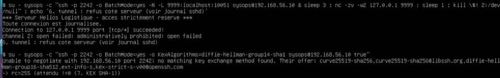

**6.** L'écoute locale du tunnel s'ouvre, mais son usage est refusé (« administratively prohibited ») : seul `helios-ops` a droit au `PermitOpen localhost:10051`. **7.** Un client qui n'offre que `diffie-hellman-group14-sha1` n'a « no matching key exchange method » : SHA-1 est banni.

---

## Figure 9 : la trace de chaque refus côté serveur (LogLevel VERBOSE)

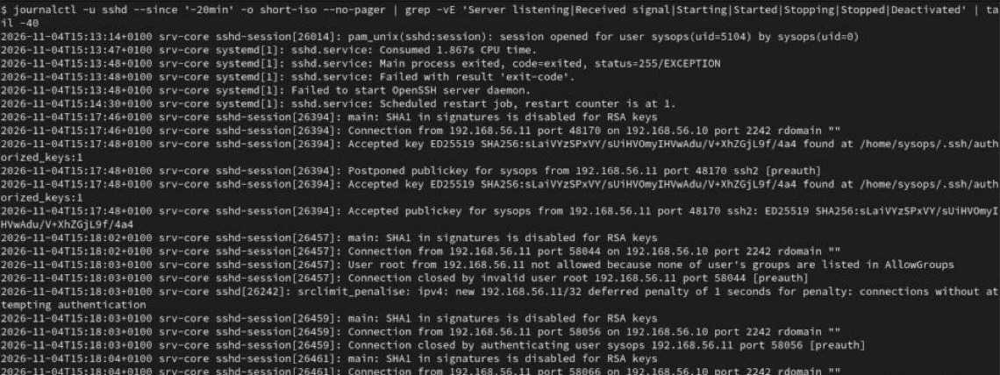

`journalctl -u sshd` relie chaque test à une ligne :

- `Accepted publickey for sysops … ED25519 SHA256:sLai…` (l'empreinte de la clé identifie l'administrateur) ;
- `User root/nadia … not allowed because none of user's groups are listed in AllowGroups` ;
- `Connection closed by authenticating user sysops [preauth]` pour le test du mot de passe ;
- `no matching key exchange method` pour le test SHA-1.

On voit aussi l'échec SELinux de la figure 5.

## Figure 10 : journald persistant, les journaux survivent aux redémarrages

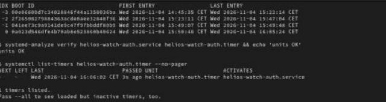

Le drop-in `journald.conf.d/50-helios.conf` fixe `Storage=persistent`, un maximum de 500 Mo, rotation quotidienne, rétention d'un mois et `Seal=yes` (clé FSS générée et gardée hors du dépôt). Avant, `--list-boots` n'avait qu'**un** démarrage. Après, il en liste **5**, et celui de 14:45, antérieur à la configuration, est toujours consultable. Le timer de détection est en place.

## Figure 11 : auditd, 12 règles et exploitation

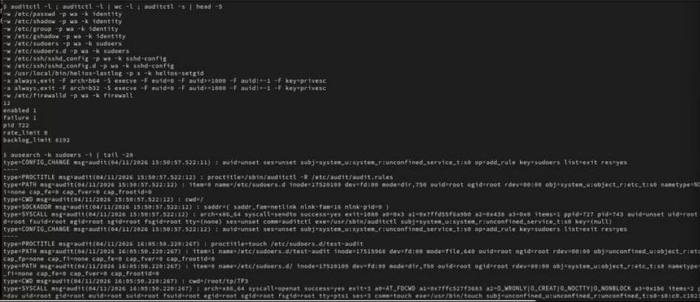

`90-helios.rules` surveille :

- l'écriture sur les fichiers d'identité, sudoers et sshd ;
- l'exécution du binaire setgid du TP2 ;
- tout `execve` root lancé par un compte humain (`auid>=1000`, en 64 et 32 bits) ;
- `/etc/firewalld/`.

`ausearch -k sudoers -i` retrouve le `touch /etc/sudoers.d/test-audit` fait en root mais attribué à **dav** grâce à l'auid, qui suit l'utilisateur à travers `sudo -i`.

---

## Figure 12 : attaque simulée, srv-edge bloquée

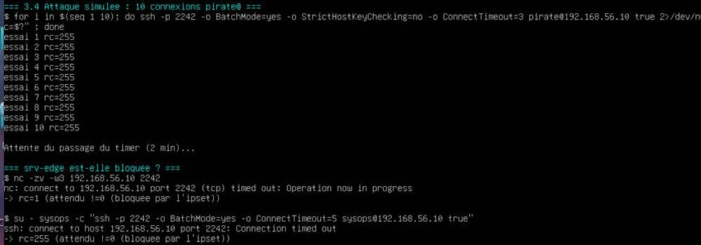

srv-edge enchaîne 10 connexions `pirate@srv-core`. Au passage suivant du timer (toutes les 2 min), elle est bannie : `nc` et `ssh` vers 2242 **expirent sans réponse**, car l'ipset applique un `drop`.

## Figure 13 : preuve côté srv-core, ipset peuplé

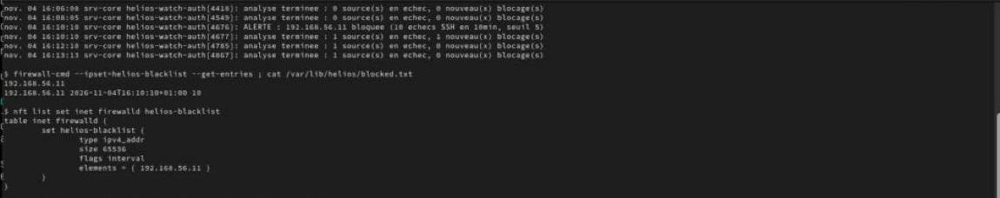

`helios-watch-auth.sh` (mode strict, verrou `flock`, `logger -t helios-watch-auth`, liste blanche 192.168.56.1) compte les échecs sshd sur 10 min glissantes. Il a journalisé `ALERTE : 192.168.56.11 bloquee (10 echecs SSH en 10min, seuil 5)`. L'adresse est dans `firewall-cmd --ipset=helios-blacklist --get-entries`, dans le set nftables et dans `/var/lib/helios/blocked.txt`. Les passages suivants n'ajoutent **aucune nouvelle alerte** (« 0 nouveau(x) blocage(s) »).

## Figure 14 : idempotence, verrou, déblocage

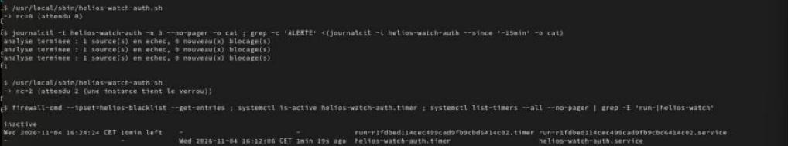

Relancé, le script rend `rc=0`, avec une seule `ALERTE` au total. Lancé pendant qu'une autre instance tient le verrou, il rend **`rc=2`**. Déblocage : arrêt du timer, `--remove-entry`, nettoyage de `blocked.txt`, puis `systemd-run --on-active=11min` relance le timer après la fenêtre. srv-edge se reconnecte ensuite (rc=0).

## Figure 15 : bonus, règles d'audit immuables (`-e 2`)

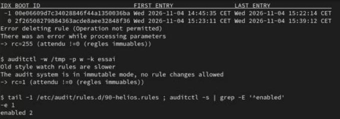

Avec `-e 2`, `auditctl -s` donne `enabled 2`. `auditctl -D` et l'ajout d'une règle échouent : même root ne peut plus effacer ses traces avant le prochain redémarrage. Le retour à `-e 1` n'a pris effet qu'au démarrage suivant. `AuthenticationMethods publickey` est une **liste blanche** de méthodes, plus sûre que `PasswordAuthentication no` seul, qui laisserait `keyboard-interactive` (PAM) possible.
